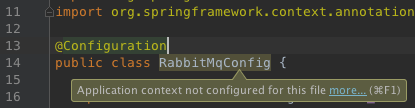
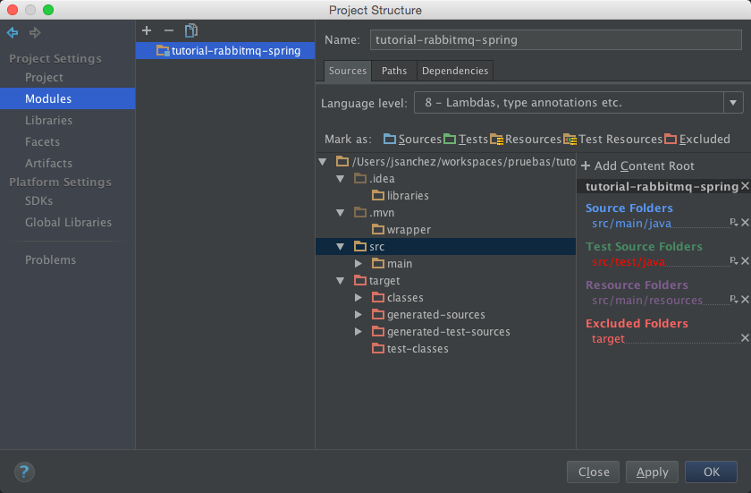
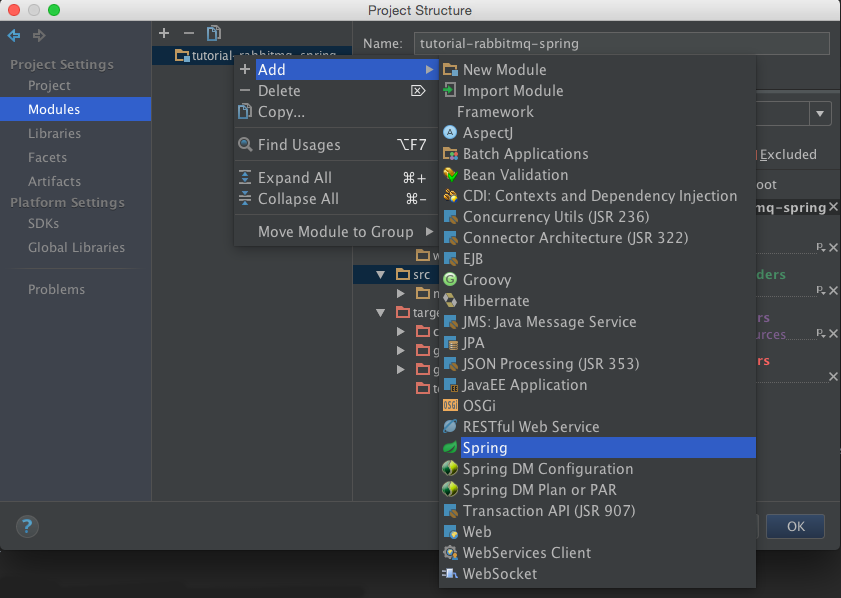
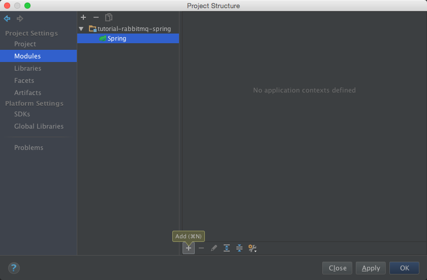
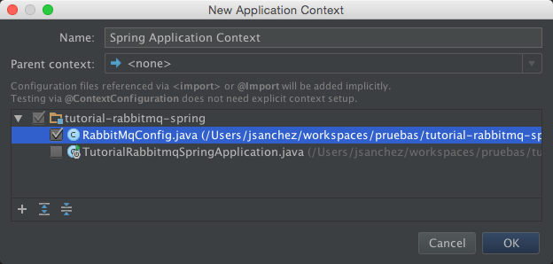
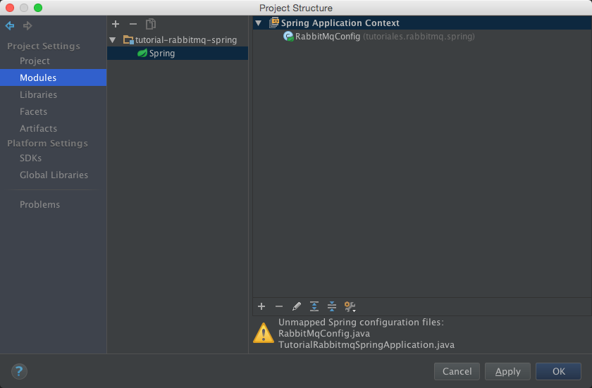

# Integración de RabbitMQ con Spring

## 1. Introducción
RabbitMQ es un popular sistema de mensajería basado en el protocolo AMQP (Advanced Message Queuing Protocol). Permite a las aplicaciones comunicarse entre sí a través de mensajes asíncronos, desacoplando la producción y el consumo de mensajes. Esto es especialmente útil en arquitecturas de microservicios y en aplicaciones que requieren alta disponibilidad y escalabilidad.

Spring Boot es un marco de trabajo que facilita la creación de aplicaciones basadas en Spring, proporcionando una configuración predeterminada y simplificando el proceso de desarrollo. Integrar RabbitMQ con Spring Boot permite aprovechar las capacidades de mensajería de RabbitMQ de manera sencilla y efectiva dentro de una aplicación Spring.

En este tutorial, aprenderás a configurar e integrar RabbitMQ en una aplicación Spring Boot. Crearemos un proyecto desde cero con [Spring Initializr](https://start.spring.io) (funciona igual sin importar el IDE que uses), configuraremos RabbitMQ, y desarrollaremos un ejemplo práctico de productor y consumidor de mensajes. Al finalizar este tutorial, tendrás una comprensión clara de cómo utilizar RabbitMQ en un entorno Spring Boot para manejar la mensajería asincrónica.

## 2. Entorno

Necesitas:

- **JDK 21**.
- **Maven 3.9** o superior. El proyecto que genera Spring Initializr trae el *Maven Wrapper* (`./mvnw`), así que no es obligatorio instalar Maven.
- **Docker**, para ejecutar el servidor de RabbitMQ sin instalarlo.
- Un **IDE** con soporte para proyectos Maven (NetBeans, IntelliJ IDEA, VS Code, Eclipse, etc. — este tutorial no depende de uno en particular).

## 3. Servidor de RabbitMQ
La forma más simple de tener un servidor de RabbitMQ es ejecutarlo en un contenedor de Docker. La imagen `management` incluye el panel de administración web:

```sh
docker run -d --name rabbitmq -p 5672:5672 -p 15672:15672 rabbitmq:4.4-management
```

- El puerto **5672** es el que usan las aplicaciones para enviar y recibir mensajes (protocolo AMQP).
- El puerto **15672** es el del panel de administración: abre [http://localhost:15672](http://localhost:15672) e ingresa con el usuario `guest` y la contraseña `guest`.

Verifica que el servidor esté listo:

```sh
docker exec rabbitmq rabbitmq-diagnostics -q ping
```

Debe responder `Ping succeeded`. Cuando termines el tutorial, detén y borra el contenedor con `docker rm -f rabbitmq`.

Si prefieres instalar RabbitMQ directamente en tu equipo, sigue las instrucciones de [rabbitmq.com](https://www.rabbitmq.com/docs/download) y ejecuta `rabbitmq-server`.

## 4. Creación del Proyecto con Spring Initializr

Lo primero que vamos a hacer es crear un proyecto Spring Boot. La forma más simple y actual de hacerlo, sin importar el IDE que uses, es a través de [Spring Initializr](https://start.spring.io):

1. Entra a [https://start.spring.io](https://start.spring.io).
2. Configura:
   - **Project**: Maven
   - **Language**: Java
   - **Spring Boot**: la versión estable más reciente de la línea 4.1.x
   - **Group**: `tutoriales.rabbitmq.spring`
   - **Artifact**: `tutorial-rabbitmq-spring`
   - **Packaging**: Jar
   - **Java**: 21
3. En "Dependencies", agrega **Spring for RabbitMQ** (`spring-boot-starter-amqp`).
4. Haz clic en "Generate" para descargar el `.zip`, descomprímelo, y ábrelo en tu IDE como un proyecto Maven existente (la mayoría de IDEs lo detectan automáticamente al abrir la carpeta o el `pom.xml`).
5. Espera a que el IDE descargue las dependencias.

En este momento ya tenemos una aplicación que se puede ejecutar (el método `main` usa `SpringApplication.run` para ejecutarla) — aunque todavía no hace nada interesante. La probamos ejecutando la clase `TutorialRabbitmqSpringApplication` (desde el IDE, con clic derecho → Run, o por consola con `./mvnw spring-boot:run`, o `mvnw.cmd spring-boot:run` en Windows).

El `pom.xml` generado queda así:

```xml
<?xml version="1.0" encoding="UTF-8"?>
<project xmlns="http://maven.apache.org/POM/4.0.0"
         xmlns:xsi="http://www.w3.org/2001/XMLSchema-instance"
         xsi:schemaLocation="http://maven.apache.org/POM/4.0.0 https://maven.apache.org/xsd/maven-4.0.0.xsd">
    <modelVersion>4.0.0</modelVersion>

    <parent>
        <groupId>org.springframework.boot</groupId>
        <artifactId>spring-boot-starter-parent</artifactId>
        <version>4.1.1</version>
        <relativePath/>
    </parent>

    <groupId>tutoriales.rabbitmq.spring</groupId>
    <artifactId>tutorial-rabbitmq-spring</artifactId>
    <version>0.0.1-SNAPSHOT</version>
    <name>tutorial-rabbitmq-spring</name>
    <description>RabbitMQ con Spring</description>

    <properties>
        <java.version>21</java.version>
    </properties>

    <dependencies>
        <dependency>
            <groupId>org.springframework.boot</groupId>
            <artifactId>spring-boot-starter-amqp</artifactId>
        </dependency>

        <dependency>
            <groupId>org.springframework.boot</groupId>
            <artifactId>spring-boot-starter-amqp-test</artifactId>
            <scope>test</scope>
        </dependency>
    </dependencies>

    <build>
        <plugins>
            <plugin>
                <groupId>org.springframework.boot</groupId>
                <artifactId>spring-boot-maven-plugin</artifactId>
            </plugin>
        </plugins>
    </build>
</project>
```

## 5. Implementación

El proyecto constará de tres clases: `TutorialRabbitmqSpringApplication`, `Receiver` y `RabbitMqConfig`.

Receiver.java

```java
package tutoriales.rabbitmq.spring;

public class Receiver {

    public static final String RECEIVE_METHOD_NAME = "receiveMessage";

    public void receiveMessage(String message) {
        System.out.println("[Receiver] ha recibido el mensaje \"" + message + '"');
    }
}
```

Receiver simplemente se encarga de imprimir el mensaje recibido.

RabbitMqConfig.java

```java
package tutoriales.rabbitmq.spring;

import org.springframework.amqp.core.Binding;
import org.springframework.amqp.core.BindingBuilder;
import org.springframework.amqp.core.Queue;
import org.springframework.amqp.core.TopicExchange;
import org.springframework.amqp.rabbit.connection.ConnectionFactory;
import org.springframework.amqp.rabbit.listener.SimpleMessageListenerContainer;
import org.springframework.amqp.rabbit.listener.adapter.MessageListenerAdapter;
import org.springframework.context.annotation.Bean;
import org.springframework.context.annotation.Configuration;

@Configuration
public class RabbitMqConfig {

    public static final String EXCHANGE_NAME = "exchange_name";
    public static final String ROUTING_KEY = "routing_key";

    private static final String QUEUE_NAME = "queue_name";
    private static final boolean IS_DURABLE_QUEUE = true;

    @Bean
    Queue queue() {
        return new Queue(QUEUE_NAME, IS_DURABLE_QUEUE);
    }

    @Bean
    TopicExchange exchange() {
        return new TopicExchange(EXCHANGE_NAME);
    }

    @Bean
    Binding binding(Queue queue, TopicExchange exchange) {
        return BindingBuilder.bind(queue).to(exchange).with(ROUTING_KEY);
    }

    @Bean
    SimpleMessageListenerContainer container(ConnectionFactory connectionFactory, MessageListenerAdapter listenerAdapter) {
        final SimpleMessageListenerContainer container = new SimpleMessageListenerContainer();
        container.setConnectionFactory(connectionFactory);
        container.setQueueNames(QUEUE_NAME);
        container.setMessageListener(listenerAdapter);
        return container;
    }

    @Bean
    Receiver receiver() {
        return new Receiver();
    }

    @Bean
    MessageListenerAdapter listenerAdapter(Receiver receiver) {
        return new MessageListenerAdapter(receiver, Receiver.RECEIVE_METHOD_NAME);
    }
}
```

La clase RabbitMqConfig viene anotada con `@Configuration` para indicar a Spring que contendrá definiciones de beans, los cuales son aquellos métodos que están anotados con `@Bean`. Vamos a ver para qué sirve cada uno:

```java
@Bean
Queue queue() {
    return new Queue(QUEUE_NAME, IS_DURABLE_QUEUE);
}
```

Crea una cola a la que le otorga un nombre y le define su durabilidad. Una cola durable sobrevive a un reinicio del servidor. Desde RabbitMQ 4 las colas no durables compartidas están en desuso y el servidor las rechaza con el error ``Feature `transient_nonexcl_queues` is deprecated``, por eso la cola se declara durable.

```java
@Bean
TopicExchange exchange() {
    return new TopicExchange(EXCHANGE_NAME);
}
```

Crea un exchange de tipo topic y le asigna un nombre.

```java
@Bean
Binding binding(Queue queue, TopicExchange exchange) {
    return BindingBuilder.bind(queue).to(exchange).with(ROUTING_KEY);
}
```

Enlaza una cola con un exchange de tipo topic. Con with se define la clave del enlace.

```java
@Bean
SimpleMessageListenerContainer container(ConnectionFactory connectionFactory, MessageListenerAdapter listenerAdapter) {
    final SimpleMessageListenerContainer container = new SimpleMessageListenerContainer();
    container.setConnectionFactory(connectionFactory);
    container.setQueueNames(QUEUE_NAME);
    container.setMessageListener(listenerAdapter);
    return container;
}
```

Contenedor en el que se indican quiénes son los consumidores de las colas.

```java
@Bean
Receiver receiver() {
    return new Receiver();
}
```

Receptor del mensaje.

```java
@Bean
MessageListenerAdapter listenerAdapter(Receiver receiver) {
    return new MessageListenerAdapter(receiver, Receiver.RECEIVE_METHOD_NAME);
}
```

Adaptador para indicar quién recibe el mensaje y qué método lo procesa.

**Nota (solo IntelliJ IDEA)**: si usas IntelliJ y te aparece el aviso de que el contexto de la aplicación no está configurado para RabbitMqConfig, como se ve en la siguiente imagen (no debería pasar si generaste el proyecto con Spring Initializr, pero por si acaso):



entonces deberás ir a «File / Project Structure… / Project Settings / Modules»:



hacer clic derecho en «tutorial-rabbitmq-spring», «Add / Spring»:



y seguir estos pasos:





TutorialRabbitmqSpringApplication.java

```java
package tutoriales.rabbitmq.spring;

import org.springframework.amqp.rabbit.core.RabbitTemplate;
import org.springframework.boot.CommandLineRunner;
import org.springframework.boot.SpringApplication;
import org.springframework.boot.autoconfigure.SpringBootApplication;

@SpringBootApplication
public class TutorialRabbitmqSpringApplication implements CommandLineRunner {

    private static final String MESSAGE = "Hello world!";

    private final RabbitTemplate rabbitTemplate;

    public TutorialRabbitmqSpringApplication(RabbitTemplate rabbitTemplate) {
        this.rabbitTemplate = rabbitTemplate;
    }

    public static void main(String[] args) {
        SpringApplication.run(TutorialRabbitmqSpringApplication.class, args);
    }

    @Override
    public void run(String... args) {
        System.out.println("[Application] Enviando el mensaje \"" + MESSAGE + "\"...");
        rabbitTemplate.convertAndSend(RabbitMqConfig.EXCHANGE_NAME, RabbitMqConfig.ROUTING_KEY, MESSAGE);
    }
}
```

La clase `TutorialRabbitmqSpringApplication` está anotada con `@SpringBootApplication`. Esta anotación, propia de Spring Boot, equivale a añadir las siguientes:

- `@Configuration`: Indica que contiene beans.
- `@EnableAutoConfiguration`: Activa la autoconfiguración del contexto de aplicación de Spring para que busque los beans que se van a necesitar.
- `@ComponentScan`: Dice a Spring que busque componentes, configuraciones y servicios en el paquete de la clase.

Spring entrega el bean `RabbitTemplate` a través del constructor (inyección por constructor), que es la forma recomendada frente a `@Autowired` sobre un atributo. En concreto, este template nos ayuda a enviar y recibir mensajes de una manera realmente sencilla: a través del método `convertAndSend` indicamos que queremos enviar el mensaje `MESSAGE` a las colas que tengan un enlace al exchange `EXCHANGE_NAME` con clave `ROUTING_KEY`.


### 5.1. Configuración de RabbitMQ
La conexión con el servidor de RabbitMQ se puede configurar a través del archivo `application.properties`, que admite las siguientes propiedades:

`application.properties`:

```properties
# RabbitMQ properties
spring.rabbitmq.host=
spring.rabbitmq.port=
spring.rabbitmq.addresses=
spring.rabbitmq.username=
spring.rabbitmq.password=
spring.rabbitmq.virtual-host=
spring.rabbitmq.dynamic=
```
Si se omiten, por defecto tomará: localhost, el puerto 5672, el usuario guest, la contraseña guest y el host virtual /. Con el contenedor del paso 3 no hace falta configurar nada.

Cada propiedad también se puede definir con una variable de entorno, por ejemplo `SPRING_RABBITMQ_HOST` o `SPRING_RABBITMQ_PASSWORD`. Así las credenciales de un servidor real no quedan en el código ni en el repositorio.

## 6. Ejecución
Con el contenedor de RabbitMQ en marcha (paso 3), inicia la aplicación desde el IDE o por consola:

```sh
./mvnw spring-boot:run
```

Por consola, además de la salida propia de Spring Boot, deberá aparecer:

```
[Application] Enviando el mensaje "Hello world!"...
[Receiver] ha recibido el mensaje "Hello world!"
```

La aplicación sigue en ejecución porque el consumidor queda escuchando la cola; detenla con `Ctrl+C`. En el panel de administración, en la pestaña **Queues and Streams**, verás la cola `queue_name` y en **Exchanges** el exchange `exchange_name`.

## 7. Para entregar

Entregue el enlace al repositorio con el proyecto y un `INFORME.md` con la salida de la ejecución.

### Criterios de evaluación

* Proyecto.
	1. El proyecto se generó con Spring Initializr con la dependencia *Spring for RabbitMQ* y compila con `mvn package`.
* Configuración.
	1. La conexión a RabbitMQ se define en `application.properties` (o por variables de entorno), no en el código.
* Funcionalidad.
	1. Al ejecutar la aplicación, el log muestra que el productor envía el mensaje y que el `Receiver` lo recibe.
* Extensión.
	1. Envía un objeto como JSON (por ejemplo, un pedido con varios campos) usando un convertidor de mensajes JSON, y el consumidor lo recibe como objeto.
	2. Agrega un segundo consumidor y explica en el informe cómo se reparten los mensajes entre los dos.

## 8. Conclusiones
La integración de RabbitMQ con Spring no tiene ninguna dificultad, pues en un rato hemos sido capaces de crear desde cero un proyecto que se sirve del framework Spring para enviar mensajes a través de RabbitMQ.

---

## Créditos y uso académico

**Autor:** César Augusto Vega Fernández  
**Curso:** Diseño y Arquitectura de Software  
**Programa:** Ingeniería Informática – Universidad de La Sabana

### Licencia de uso

Este material se distribuye bajo la licencia [Creative Commons Atribución-NoComercial-CompartirIgual 4.0 Internacional (CC BY-NC-SA 4.0)](https://creativecommons.org/licenses/by-nc-sa/4.0/deed.es). El texto completo está en el archivo [`LICENSE`](LICENSE).

Puedes **usar, adaptar o compartir** este contenido con fines educativos, siempre que:

1. Se reconozca la autoría del profesor **César Augusto Vega Fernández**.
2. No se utilice con fines comerciales.
3. Las obras derivadas se distribuyan bajo la misma licencia.
